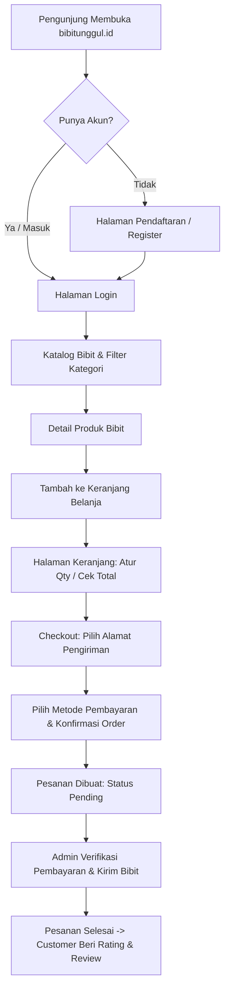
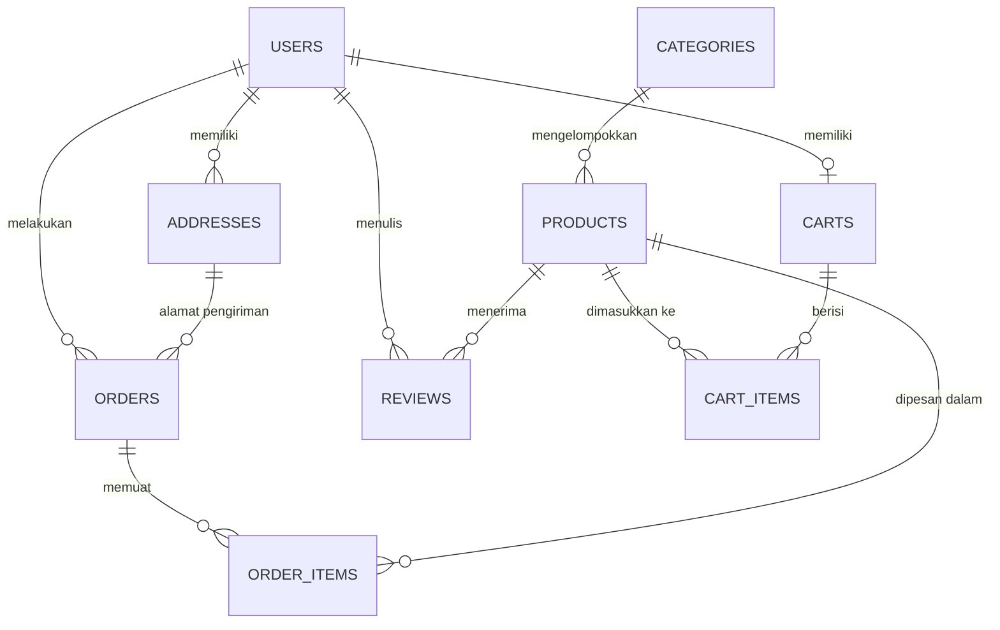

# Product Requirement Document (PRD)
## bibitunggul.id — Marketplace Bibit Tanaman Berkualitas Unggul

| **Dokumen ID** | **PRD-TIF2001-TIM07-001** |
|---|---|
| **Proyek** | `bibitunggul.id` |
| **Mata Kuliah** | TIF2001 Software Development |
| **Tim Pengembang** | Tim 7 |
| **Repositori Utama** | `Kangeldy/tif2001--Tim-7---bibitunggul.id-` |
| **Versi Dokumen** | 1.0.0 (Final Draft) |
| **Status** | Disetujui (Approved for Sprint Execution) |
| **Tanggal Pembuatan** | 5 November 2026 |

---

## 1. Executive Summary & Latar Belakang

### 1.1 Latar Belakang Masalah
Minat masyarakat terhadap pertanian perkotaan (*urban farming*), budidaya tanaman hortikultura rumahan, dan agribisnis skala mikro terus melonjak. Namun, calon pembeli bibit sering menghadapi tantangan mendasar:
1. **Ketidakpastian Kualitas Bibit:** Maraknya penjualan bibit varietas palsu, persentase daya kecambah (*germination rate*) rendah, serta tidak adanya petunjuk masa semai.
2. **Fragmentasi Saluran Penjualan:** Penjual bibit tanaman tersebar di berbagai forum media sosial tanpa standardisasi inventori stok dan sistem transaksi yang aman.
3. **Risiko Logistik Tanaman Hidup:** Bibit rentan layu atau mati dalam perjalanan, memerlukan kejelasan estimasi waktu pengiriman, pemilihan varietas tahan banting, serta panduan pengemasan khusus.

### 1.2 Solusi Produk: bibitunggul.id
`bibitunggul.id` hadir sebagai platform marketplace bibit tanaman online terkurasi yang mempertemukan para penghobi kebun, petani pemula, dan pembudidaya dengan katalog bibit tanaman (buah, sayuran, tanaman hias, rempah) berkualitas unggul. Platform ini memfasilitasi transaksi end-to-end yang aman, transparan, didukung manajemen keranjang belanja, integrasi Supabase PostgreSQL yang tangguh, sistem autentikasi aman, serta pelacakan status pesanan secara real-time.

### 1.3 Key Objectives & Success Metrics (OKRs)
* **Objective 1:** Menyediakan sistem katalog bibit yang cepat, responsif, dan akurat.
  * *KR 1.1:* Response time query produk dan kategori < 250ms pada koneksi jaringan standar.
  * *KR 1.2:* 100% data stok tersinkronisasi realtime dan mencegah over-selling saat checkout.
* **Objective 2:** Membangun pengalaman pengguna (UX) yang intuitif untuk pembeli umum dan kemudahan operasional untuk admin.
  * *KR 2.1:* Flow checkout selesai dalam kurang dari 4 langkah (Pilih -> Keranjang -> Alamat -> Bayar).
  * *KR 2.2:* Mobile-first responsive layout (Lighthouse Performance > 85, Accessibility > 90).
* **Objective 3:** Standar rekayasa perangkat lunak tim yang solid dan terotomatisasi.
  * *KR 3.1:* Pipeline CI/CD di GitHub Actions selalu berstatus *green* (lolos uji lint dan Jest test suite).
  * *KR 3.2:* Keamanan database dengan enkripsi password (bcrypt), validasi token JWT, dan Row-Level Security (RLS).

---

## 2. Struktur Tim & Pembagian Peran (RACI Matrix)

Sesuai dengan *Roadmap Alur Pengerjaan Tim 7*, pembagian peran teknis adalah sebagai berikut:

| Peran | Anggota / Divisi | Tanggung Jawab Utama | Workspace Directory | Branch Pattern |
|---|---|---|---|---|
| **Frontend Engineer** | Tim Frontend | - UI/UX React + Vite + Tailwind CSS<br>- Navigasi SPA & State Management<br>- Form validation (Zod) & API calls | `frontend/` | `feat/frontend-*` |
| **Backend Engineer** | Tim Backend | - REST API Express.js + Supabase SDK<br>- Autentikasi JWT & Bcrypt hashing<br>- Query optimasi & transaksi DB | `backend/` | `feat/backend-*` |
| **QA / DevOps** | Tim QA & DevOps | - Setup CI/CD GitHub Actions<br>- Unit & Integration Testing (Jest)<br>- Dokumentasi API (`docs/`) & Rilis | `.github/`, `docs/` | `test/*`, `chore/*` |

---

## 3. User Personas & Use Case

### 3.1 Personas
1. **Rian Pratama (28 th) — Urban Gardening Hobbyist (Customer):**
   * *Karakter:* Tinggal di perumahan kota, ingin menanam cabai rawit, tomat, dan jeruk santang di pekarangan rumah.
   * *Kebutuhan:* Memilih bibit yang terjamin tumbuh subur, deskripsi perawatan bibit yang jelas, proses belanja yang cepat via smartphone, dan estimasi barang sampai.
2. **Siti Rahma (45 th) — Petani Sayur Organik Skala Rumahan (Customer Bulk):**
   * *Karakter:* Membutuhkan pesanan bibit sayuran dalam jumlah banyak secara berkala.
   * *Kebutuhan:* Kemudahan menambahkan item dalam jumlah besar ke keranjang, riwayat pesanan yang jelas untuk pembukuan, serta kemudahan komunikasi/ulasan.
3. **Admin Bibit Unggul (Internal Operator):**
   * *Karakter:* Bertanggung jawab menjaga katalog bibit tetap mutakhir, memverifikasi pembayaran pesanan, memperbarui nomor resi/status ekspedisi, dan mengelola stok bibit.
   * *Kebutuhan:* Dashboard terproteksi, pencatatan mutasi stok otomatis, dan tampilan list order yang mudah difilter.

### 3.2 Diagram Alur Pengguna (User Journey Flow)


---

## 4. Ruang Lingkup Produk (Product Scope & Roadmap)

### 4.1 Sprint 1: Fondasi & Core Commerce (Target Utama)
* **Fondasi:**
  * Inisialisasi skema database PostgreSQL di Supabase (tabel `users`, `addresses`, `categories`, `products`, `carts`, `cart_items`, `orders`, `order_items`, `reviews`).
  * Konfigurasi Express.js server dengan struktur modular (controllers, routes, services, middlewares).
  * Konfigurasi frontend React + Vite + Tailwind CSS + React Router.
  * Pipeline CI/CD GitHub Actions (`ci.yml`) aktif untuk lint dan test matrix.
* **Fitur Inti:**
  * Autentikasi Pengguna: Registrasi, Login (JWT Token), Logout, Role (`customer` & `admin`).
  * Katalog Produk Publik: Menampilkan daftar produk bibit, filter kategori (Buah, Sayuran, Hias, Rempah), pagination/infinite scroll, detail produk.
* **Transaksi:**
  * Keranjang Belanja: Tambah produk, ubah kuantitas, hapus item, simpan cart persisten di database & sinkronisasi local storage.
  * Checkout & Pesanan: Pilih alamat tersimpan atau tambah alamat baru, generate invoice/nomor order unik, pemotongan stok otomatis.

### 4.2 Sprint 2: Manajemen Transaksi, Review & Tracking
* Manajemen Pesanan Customer: Halaman "Pesanan Saya", status order (`pending`, `paid`, `processing`, `shipped`, `completed`, `cancelled`).
* Modul Ulasan & Rating: Form review produk bibit (1-5 bintang + komentar ulasan kualitas bibit) hanya untuk produk yang pernah dibeli.
* Dashboard Admin: Kelola CRUD produk bibit, ubah stok, ubah status pesanan, input resi ekspedisi.

### 4.3 Sprint 3 (Future Enhancements):
* Integrasi Midtrans Payment Gateway (Snap API).
* Cek Ongkos Kirim Otomatis (RajaOngkir API).
* Notifikasi email status pesanan (Resend/SendGrid).
* Artikel & Panduan Semai Bibit (Knowledge Base).

---

## 5. Kebutuhan Fungsional (Functional Requirements)

### 5.1 Modul Autentikasi & Akun Pengguna (AUTH)
| Kode | Deskripsi Kebutuhan | Aktor | Kriteria Penerimaan (Acceptance Criteria) |
|---|---|---|---|
| **FR-AUTH-01** | Pendaftaran Akun (Register) | Customer | Menginput nama lengkap, email valid (unik), password minimal 8 karakter, dan nomor telepon opsional. Password di-hash menggunakan bcrypt sebelum disimpan ke database. |
| **FR-AUTH-02** | Masuk ke Sistem (Login) | Customer, Admin | Menginput email & password terdaftar. Sistem memvalidasi kredensial dan menerbitkan JWT Token beserta role user (`customer` / `admin`). |
| **FR-AUTH-03** | Manajemen Sesi & Logout | Customer, Admin | Token JWT disimpan aman di frontend (LocalStorage / Cookie). Logout menghapus token dari state klien. |
| **FR-AUTH-04** | Role-Based Access Control | Sistem | Route backend terproteksi memvalidasi token via middleware `verifyAuth`. Endpoint khusus admin diproteksi oleh `verifyAdmin`. |

### 5.2 Modul Buku Alamat Pengiriman (ADDRESS)
| Kode | Deskripsi Kebutuhan | Aktor | Kriteria Penerimaan (Acceptance Criteria) |
|---|---|---|---|
| **FR-ADDR-01** | Tambah Alamat Pengiriman | Customer | Menginput nama penerima, no handphone aktif, alamat lengkap, kota/kabupaten, dan kode pos. |
| **FR-ADDR-02** | Set Alamat Utama (Default) | Customer | Menentukan salah satu alamat sebagai alamat default saat checkout. |
| **FR-ADDR-03** | Update & Hapus Alamat | Customer | Pelanggan dapat memperbarui rincian alamat atau menghapus alamat yang tidak digunakan. |

### 5.3 Modul Katalog & Kategori Bibit (CATALOG)
| Kode | Deskripsi Kebutuhan | Aktor | Kriteria Penerimaan (Acceptance Criteria) |
|---|---|---|---|
| **FR-CAT-01** | Daftar Kategori Bibit | Publik, Customer | Mengambil seluruh kategori bibit (Buah, Sayuran, Tanaman Hias, Rempah) lengkap dengan slug dan deskripsi. |
| **FR-CAT-02** | Menampilkan Katalog Produk | Publik, Customer | Menampilkan daftar bibit aktif (`is_active = true`) dengan atribut nama bibit, foto, harga, kategori, dan sisa stok. |
| **FR-CAT-03** | Filter & Pencarian Bibit | Publik, Customer | Pengguna dapat memfilter berdasarkan kategori atau mencari nama bibit secara instan (debounced client-side filter / API query). |
| **FR-CAT-04** | Detail Produk Bibit | Publik, Customer | Menampilkan detail lengkap produk berdasarkan `slug`: deskripsi spesifikasi bibit, rating rata-rata, ulasan pembeli, dan ketersediaan stok. |
| **FR-CAT-05** | CRUD Produk (Admin) | Admin | Admin dapat membuat produk baru, mengedit nama/harga/stok/gambar, serta mengubah status aktif produk. |

### 5.4 Modul Keranjang Belanja (CART)
| Kode | Deskripsi Kebutuhan | Aktor | Kriteria Penerimaan (Acceptance Criteria) |
|---|---|---|---|
| **FR-CART-01** | Tambah Bibit ke Keranjang | Customer | Pengguna dapat menambahkan item bibit ke keranjang. Jika item sudah ada di keranjang, kuantitas bertambah secara otomatis. |
| **FR-CART-02** | Validasi Batas Stok | Customer, Sistem | Kuantitas yang diminta di keranjang tidak boleh melebihi sisa stok fisik yang tersedia di database. |
| **FR-CART-03** | Update Kuantitas & Hapus Item | Customer | Mengubah angka kuantitas secara instan (0ms Optimistic UI) atau menghapus produk dari keranjang belanja. |
| **FR-CART-04** | Hitung Total Belanja | Customer | Menghitung subtotal per item (`price * quantity`) dan total harga pesanan secara otomatis. |

### 5.5 Modul Checkout & Transaksi Pesanan (ORDER)
| Kode | Deskripsi Kebutuhan | Aktor | Kriteria Penerimaan (Acceptance Criteria) |
|---|---|---|---|
| **FR-ORD-01** | Proses Checkout | Customer | Memilih alamat pengiriman, memilih metode pembayaran (Transfer Bank / Manual / Gateway), dan mengonfirmasi pesanan. |
| **FR-ORD-02** | Pembuatan Pesanan (Create Order) | Sistem | - Menghasilkan `order_number` unik (misal: `ORD-20261105-XXXX`).<br>- Menyalin data item ke tabel `order_items` (snapshot harga & nama produk saat transaksi).<br>- Mengurangi stok produk di tabel `products`.<br>- Mengosongkan keranjang belanja pengguna. |
| **FR-ORD-03** | Status Transaksi | Customer, Admin | Status pesanan mencakup: `pending` -> `paid` -> `processing` -> `shipped` -> `completed` -> `cancelled`. |
| **FR-ORD-04** | Riwayat Pesanan Customer | Customer | Menampilkan daftar seluruh transaksi yang pernah dilakukan pengguna berserta rincian barang, total pembayaran, dan status saat ini. |
| **FR-ORD-05** | Manajemen Pesanan (Admin) | Admin | Admin dapat memfilter pesanan masuk, memverifikasi pembayaran (`paid`), mengubah status menjadi `shipped`, dan menyelesaikan order. |

### 5.6 Modul Ulasan & Rating (REVIEW)
| Kode | Deskripsi Kebutuhan | Aktor | Kriteria Penerimaan (Acceptance Criteria) |
|---|---|---|---|
| **FR-REV-01** | Memberikan Ulasan Produk | Customer | Pengguna yang telah menyelesaikan pesanan (`completed`) dapat memberikan rating (1 sampai 5) dan ulasan teks mengenai kualitas benih/bibit. |
| **FR-REV-02** | Menampilkan Review di Produk | Publik, Customer | Daftar ulasan dan rata-rata skor bintang tampil di halaman detail produk bibit bersangkutan. |

---

## 6. Kebutuhan Non-Fungsional (Non-Functional Requirements)

1. **Keamanan (Security):**
   * Password pengguna wajib disimpan dalam bentuk hash terenkripsi menggunakan algoritma `bcrypt` (salt rounds >= 10).
   * Seluruh request privat wajib dilindungi header `Authorization: Bearer <jwt_token>`.
   * Sanitasi data input di layer API menggunakan schema validator (Zod / Joi) untuk memitigasi serangan XSS dan Injeksi SQL.
   * Kebijakan Row-Level Security (RLS) diaktifkan pada Supabase PostgreSQL untuk melindungi akses publik langsung ke database.
2. **Performa & Latensi:**
   * Waktu respon API endpoint publik (katalog produk & kategori) tidak melebihi 250ms pada beban 50 concurrent users.
   * Optimistic UI di sisi frontend React untuk manipulasi cart dan form actions guna memberikan sensasi instan (0ms RTT visual feedback).
   * Asset gambar bibit dioptimasi (format WebP/compressed JPG) dengan CDN storage.
3. **Ketersediaan & Keandalan (Reliability & Scalability):**
   * Menggunakan infrastruktur PostgreSQL terkelola Supabase dengan jaminan uptime 99.9%.
   * Penanganan error terpusat via `errorMiddleware.js` di Express dengan format respons JSON seragam: `{ "success": false, "message": "Pesan error" }`.
4. **Desain & Responsivitas (UI/UX):**
   * Mobile-first responsive design yang adaptif di layar smartphone (375px+), tablet, dan desktop workstation.
   * Skema palet warna natural bertema agrikultur: Primary Green (`#16a34a` / `#15803d`), Forest Green Dark (`#14532d`), Neutral Slate Background (`#f8fafc`), Clean Card White (`#ffffff`), dan Accent Amber (`#f59e0b`) untuk rating bintang.

---

## 7. Arsitektur Data & Kamus Data Database

Database diimplementasikan pada PostgreSQL (Supabase Engine).



### Kamus Data Entitas Utama:

#### 1. Tabel `users`
* `id` (SERIAL, PK) — ID unik pengguna
* `name` (VARCHAR(100), NOT NULL) — Nama lengkap
* `email` (VARCHAR(150), NOT NULL, UNIQUE) — Alamat email
* `password` (VARCHAR(255), NOT NULL) — Bcrypt password hash
* `phone` (VARCHAR(20)) — Nomor kontak / WhatsApp
* `role` (VARCHAR(20), NOT NULL, DEFAULT 'customer') — Role: `'customer'` atau `'admin'`
* `created_at`, `updated_at` (TIMESTAMP)

#### 2. Tabel `addresses`
* `id` (SERIAL, PK) — ID unik alamat
* `user_id` (INTEGER, FK -> users.id, ON DELETE CASCADE)
* `recipient_name` (VARCHAR(100), NOT NULL) — Nama penerima
* `phone` (VARCHAR(20), NOT NULL) — Telepon penerima
* `full_address` (TEXT, NOT NULL) — Alamat lengkap jalan, RT/RW, nomor rumah
* `city` (VARCHAR(100), NOT NULL) — Kota / Kabupaten
* `postal_code` (VARCHAR(10)) — Kode pos
* `is_default` (BOOLEAN, DEFAULT FALSE) — Penanda alamat utama

#### 3. Tabel `categories`
* `id` (SERIAL, PK) — ID unik kategori
* `name` (VARCHAR(100), NOT NULL, UNIQUE) — Contoh: 'Buah', 'Sayuran', 'Tanaman Hias', 'Rempah'
* `slug` (VARCHAR(100), NOT NULL, UNIQUE) — URL-friendly slug
* `description` (TEXT)

#### 4. Tabel `products`
* `id` (SERIAL, PK) — ID unik produk bibit
* `category_id` (INTEGER, FK -> categories.id, ON DELETE SET NULL)
* `name` (VARCHAR(150), NOT NULL) — Nama bibit (Contoh: "Bibit Jeruk Santang Madu")
* `slug` (VARCHAR(150), NOT NULL, UNIQUE) — Slug unik untuk link produk
* `description` (TEXT) — Deskripsi, cara tanam, masa semai
* `price` (NUMERIC(12,2), NOT NULL, CHECK >= 0) — Harga per pack/polybag
* `stock` (INTEGER, NOT NULL, DEFAULT 0, CHECK >= 0) — Stok siap kirim
* `image_url` (VARCHAR(255)) — Tautan foto bibit
* `is_active` (BOOLEAN, DEFAULT TRUE) — Status visibilitas di katalog
* `created_at`, `updated_at` (TIMESTAMP)

#### 5. Tabel `carts` & `cart_items`
* `carts`: `id` (SERIAL, PK), `user_id` (INTEGER, FK -> users.id, ON DELETE CASCADE), `created_at`
* `cart_items`: `id` (SERIAL, PK), `cart_id` (INTEGER, FK -> carts.id), `product_id` (INTEGER, FK -> products.id), `quantity` (INTEGER, CHECK > 0), UNIQUE(cart_id, product_id)

#### 6. Tabel `orders` & `order_items`
* `orders`:
  * `id` (SERIAL, PK)
  * `user_id` (INTEGER, FK -> users.id)
  * `address_id` (INTEGER, FK -> addresses.id)
  * `order_number` (VARCHAR(50), NOT NULL, UNIQUE)
  * `status` (VARCHAR(30), DEFAULT 'pending') — CHECK: `'pending'`,`'paid'`,`'processing'`,`'shipped'`,`'completed'`,`'cancelled'`
  * `total_amount` (NUMERIC(12,2), NOT NULL)
  * `payment_method` (VARCHAR(50))
  * `created_at`, `updated_at` (TIMESTAMP)
* `order_items`:
  * `id` (SERIAL, PK)
  * `order_id` (INTEGER, FK -> orders.id)
  * `product_id` (INTEGER, FK -> products.id)
  * `product_name` (VARCHAR(150), NOT NULL) — Snapshot nama saat transaksi
  * `price` (NUMERIC(12,2), NOT NULL) — Snapshot harga saat transaksi
  * `quantity` (INTEGER, NOT NULL)
  * `subtotal` (NUMERIC(12,2), NOT NULL)

#### 7. Tabel `reviews`
* `id` (SERIAL, PK)
* `product_id` (INTEGER, FK -> products.id)
* `user_id` (INTEGER, FK -> users.id)
* `rating` (INTEGER, NOT NULL, CHECK 1 - 5)
* `comment` (TEXT)
* `created_at` (TIMESTAMP)

---

## 8. Spesifikasi Endpoint API (API Contract)

Base URL Pengembangan: `http://localhost:5000/api` (atau Supabase REST API `https://PROJECT_ID.supabase.co/rest/v1`)

### Format Response Standar:
* **Berhasil (Success):**
  ```json
  {
    "success": true,
    "message": "Pesan status berhasil",
    "data": { ... }
  }
  ```
* **Gagal (Error):**
  ```json
  {
    "success": false,
    "message": "Deskripsi kesalahan validasi atau otorisasi"
  }
  ```

### Daftar Endpoint Inti:
| Modul | Method | Endpoint | Auth | Deskripsi |
|---|---|---|---|---|
| **Auth** | `POST` | `/api/auth/register` | Publik | Mendaftarkan akun customer baru |
| **Auth** | `POST` | `/api/auth/login` | Publik | Login & mendapatkan Bearer Token JWT |
| **Auth** | `GET` | `/api/auth/me` | User | Mengambil profil user yang sedang login |
| **Products** | `GET` | `/api/products` | Publik | Mengambil katalog bibit dengan filter & pagination |
| **Products** | `GET` | `/api/products/:slug` | Publik | Mengambil detail spesifikasi bibit berdasarkan slug |
| **Products** | `POST` | `/api/products` | Admin | Menambah varietas bibit baru |
| **Products** | `PUT` | `/api/products/:id` | Admin | Memperbarui data bibit / update stok |
| **Products** | `DELETE`| `/api/products/:id` | Admin | Menghapus atau menonaktifkan bibit |
| **Categories**| `GET` | `/api/categories` | Publik | Mendapatkan seluruh daftar kategori bibit |
| **Cart** | `GET` | `/api/cart` | User | Mengambil daftar belanjaan di keranjang aktif |
| **Cart** | `POST` | `/api/cart/items` | User | Menambah kuantitas bibit ke keranjang |
| **Cart** | `PUT` | `/api/cart/items/:id`| User | Mengubah kuantitas bibit di keranjang |
| **Cart** | `DELETE`| `/api/cart/items/:id`| User | Menghapus item tertentu dari keranjang |
| **Orders** | `POST` | `/api/orders` | User | Checkout pesanan & membuat order baru |
| **Orders** | `GET` | `/api/orders` | User | Melihat daftar riwayat pesanan user |
| **Orders** | `GET` | `/api/orders/:id` | User | Melihat detail rincian invoice pesanan |
| **Orders** | `PATCH` | `/api/orders/:id/status`| Admin | Memperbarui status pesanan (paid, shipped, dll.) |
| **Reviews** | `POST` | `/api/reviews` | User | Mengirim rating dan ulasan bibit yang dibeli |

---

## 9. Alur Kerja Git & Tata Kelola Kode (Tim 7 SOP)

1. **Aturan Repositori:**
   * Bekerja langsung di repositori utama `Kangeldy/tif2001--Tim-7---bibitunggul.id-` (bukan fork).
   * **DILARANG push langsung ke branch `main`.**
2. **Branching Convention:**
   * Fitur Frontend: `feat/frontend-<nama-fitur>` (contoh: `feat/frontend-login`, `feat/frontend-cart`)
   * Fitur Backend: `feat/backend-<nama-fitur>` (contoh: `feat/backend-orders`, `feat/backend-auth`)
   * Perbaikan Bug: `fix/<nama-bug>`
   * Dokumentasi & Maintenance: `chore/<nama-tugas>`
3. **Commit Message Standard:**
   * Format: `<type>(<scope>): <pesan>`
   * Contoh: `feat(auth): implementasi jwt sign and bcrypt compare`, `fix(cart): perbaiki perhitungan subtotal saat stok 0`
4. **Pull Request (PR) & Code Review:**
   * PR wajib menggunakan template PR yang telah disediakan (`.github/pull_request_template.md`).
   * Seluruh checklist CI (linting & unit testing) harus lolos otomatis (*status hijau*).
   * Minimal 1 rekan tim wajib mereview dan memberikan *Approve* sebelum branch di-merge ke `main`.
5. **Kerahasiaan Kredensial (.env):**
   * File `.env` dilarang di-commit ke Git.
   * Gunakan template referensi `.env.example`.

---

## 10. Pengujian & Kriteria Keberhasilan (QA Test Scenarios)

| ID Uji | Fitur | Skenario Pengujian | Hasil yang Diharapkan |
|---|---|---|---|
| **TC-01** | Register | Mendaftar dengan email yang belum pernah dipakai dan password 8+ karakter | Akun tersimpan di tabel `users` dengan password ter-hash bcrypt. Respon status 201 Created. |
| **TC-02** | Register Unik | Mendaftar dengan email yang sudah ada | Sistem menolak pendaftaran dan mengembalikan status 400 dengan pesan "Email sudah terdaftar". |
| **TC-03** | Login Sukses | Login dengan email dan password yang sesuai | Sistem mengembalikan status 200 OK beserta token JWT dan objek profil pengguna. |
| **TC-04** | Login Gagal | Login dengan password salah | Sistem mengembalikan status 401 Unauthorized dengan pesan "Email atau password salah". |
| **TC-05** | Filter Katalog | Memilih kategori "Sayuran" pada halaman katalog | Hanya menampilkan produk yang berelasi dengan kategori sayuran dalam waktu < 200ms. |
| **TC-06** | Keranjang Stok | Menambah bibit melebihi stok yang ada | Tombol bertambah terkunci atau sistem memberikan pesan peringatan stok tidak mencukupi. |
| **TC-07** | Checkout Order | Menjalankan checkout dari keranjang dengan alamat valid | Nomor pesanan `order_number` dibuat, stok produk bibit berkurang, dan keranjang menjadi kosong. |
| **TC-08** | Admin Security | User biasa mencoba memanggil API `POST /api/products` | Server mengembalikan status 403 Forbidden dengan pesan "Endpoint ini hanya dapat diakses admin". |

---

## 11. Manajemen Risiko & Mitigasi

| Risiko | Tingkat | Dampak | Rencana Mitigasi |
|---|---|---|---|
| **Perebutan Stok Bersamaan (Race Condition):** Beberapa user memesan bibit langka di detik yang sama. | Sedang | Tinggi | Gunakan transaksi atomik di PostgreSQL (`BEGIN ... COMMIT`) atau constraint level database `CHECK (stock >= 0)`. |
| **Bocornya Kredensial Database:** Supabase Service Role Key tidak sengaja terekspos. | Tinggi | Kritis | Pisahkan penggunaan `anon_key` (publik) untuk frontend dan `service_role_key` murni di backend environment variables server. |
| **Ketidaksesuaian Kontrak API:** Tim frontend dan backend bekerja dengan struktur payload JSON yang berbeda. | Sedang | Sedang | Menjadikan dokumen PRD dan file `docs/PRD.md` sebagai *Single Source of Truth* kontrak API sebelum penulisan kode dimulai. |

---

*Dokumen ini disusun sebagai pedoman resmi rekayasa perangkat lunak untuk Tim 7 dalam mata kuliah TIF2001 Software Development.*
