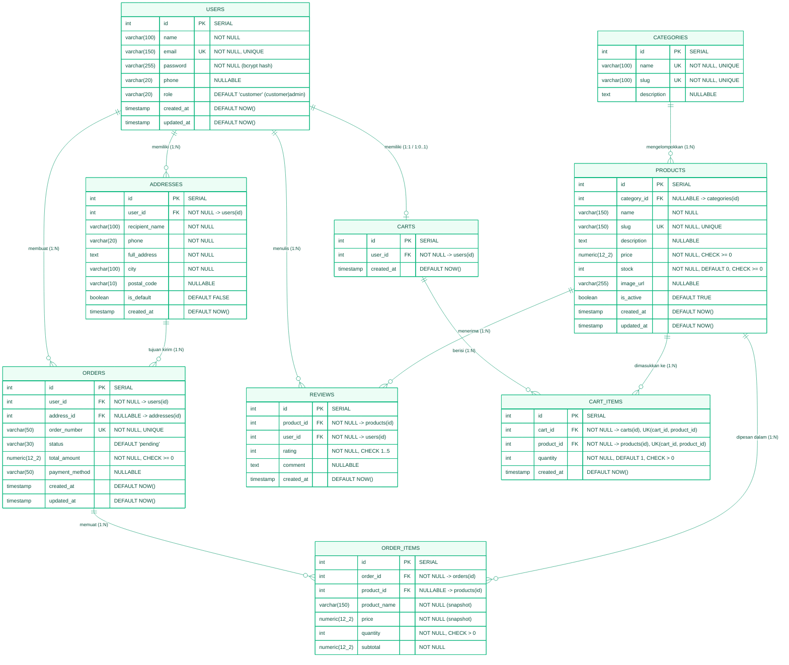

# Entity Relationship Diagram (ERD) — bibitunggul.id

Dokumen ini menyajikan rancangan **Entity Relationship Diagram (ERD)** lengkap untuk sistem database **bibitunggul.id** (PostgreSQL / Supabase) sesuai kaidah pemodelan basis data relasional (Notasi Crow's Foot, Normalisasi 1NF–3NF, Penentuan PK/FK/UK, Kardinalitas, dan Integritas Referensial).

---

## 1. Diagram ERD (Notasi Crow's Foot)

---

## 2. Kamus Entitas & Atribut (Data Dictionary)

### A. Entitas Kuat (*Strong Entities*)
1. **`users`**: Menyimpan data akun pelanggan dan administrator.
   - **PK**: `id`
   - **UK**: `email`
   - **Constraint**: `role IN ('customer', 'admin')`
2. **`categories`**: Menyimpan master kategori bibit (Buah, Sayuran, Tanaman Hias, Rempah).
   - **PK**: `id`
   - **UK**: `name`, `slug`
3. **`products`**: Menyimpan data katalog bibit tanaman.
   - **PK**: `id`
   - **FK**: `category_id` $\rightarrow$ `categories(id)`
   - **UK**: `slug`
   - **Constraint**: `price >= 0`, `stock >= 0`

### B. Entitas Lemah / Bergantung (*Dependent Entities*)
4. **`addresses`**: Menyimpan buku alamat pengiriman milik user.
   - **PK**: `id`
   - **FK**: `user_id` $\rightarrow$ `users(id)` (`ON DELETE CASCADE`)
5. **`carts`**: Menyimpan wadah keranjang belanja milik user.
   - **PK**: `id`
   - **FK**: `user_id` $\rightarrow$ `users(id)` (`ON DELETE CASCADE`)
6. **`orders`**: Menyimpan transaksi pesanan (header invoice).
   - **PK**: `id`
   - **FK**: `user_id` $\rightarrow$ `users(id)` (`ON DELETE CASCADE`), `address_id` $\rightarrow$ `addresses(id)` (`ON DELETE SET NULL`)
   - **UK**: `order_number`
   - **Constraint**: `status IN ('pending','paid','processing','shipped','completed','cancelled')`, `total_amount >= 0`
7. **`reviews`**: Menyimpan ulasan dan rating bintang (1–5) dari user untuk produk.
   - **PK**: `id`
   - **FK**: `product_id` $\rightarrow$ `products(id)` (`ON DELETE CASCADE`), `user_id` $\rightarrow$ `users(id)` (`ON DELETE CASCADE`)
   - **Constraint**: `rating BETWEEN 1 AND 5`

### C. Entitas Asosiatif / Penghubung (*Associative / Junction Entities* untuk Relasi M:N)
8. **`cart_items`**: Memecah relasi Many-to-Many (M:N) antara `carts` dan `products`.
   - **PK**: `id`
   - **FK**: `cart_id` $\rightarrow$ `carts(id)` (`ON DELETE CASCADE`), `product_id` $\rightarrow$ `products(id)` (`ON DELETE CASCADE`)
   - **Composite UK**: `UNIQUE (cart_id, product_id)` agar 1 produk tidak menjadi baris ganda di keranjang yang sama.
   - **Constraint**: `quantity > 0`
9. **`order_items`**: Memecah relasi Many-to-Many (M:N) antara `orders` dan `products`.
   - **PK**: `id`
   - **FK**: `order_id` $\rightarrow$ `orders(id)` (`ON DELETE CASCADE`), `product_id` $\rightarrow$ `products(id)` (`ON DELETE SET NULL`)
   - **Catatan Desain (Snapshot)**: Kolom `product_name` dan `price` disimpan ulang sebagai *historical snapshot* agar riwayat nota transaksi tidak berubah apabila nama/harga produk di katalog diperbarui atau produk dihapus di kemudian hari.

---

## 3. Ringkasan Kardinalitas & Aturan Integritas Referensial

| Relasi | Kardinalitas | Aturan Penghapusan (`ON DELETE`) | Alasan Bisnis |
|---|---|---|---|
| `users` $\rightarrow$ `addresses` | **1 : N** | `CASCADE` | Jika user dihapus, seluruh alamat miliknya ikut terhapus. |
| `users` $\rightarrow$ `carts` | **1 : 0..1** | `CASCADE` | Satu user maksimal memiliki satu keranjang aktif. |
| `users` $\rightarrow$ `orders` | **1 : N** | `CASCADE` | Satu user dapat melakukan banyak transaksi pesanan. |
| `users` $\rightarrow$ `reviews` | **1 : N** | `CASCADE` | Satu user dapat menulis banyak ulasan produk. |
| `categories` $\rightarrow$ `products` | **1 : N** | `SET NULL` | Jika kategori dihapus, produk tidak ikut hilang (kategori menjadi `NULL`). |
| `carts` $\leftrightarrow$ `products` (via `cart_items`) | **M : N** | `CASCADE` | Keranjang dapat menampung banyak produk; produk bisa ada di banyak keranjang. |
| `addresses` $\rightarrow$ `orders` | **1 : N** | `SET NULL` | Jika user menghapus alamatnya, data riwayat order tetap tersimpan. |
| `orders` $\leftrightarrow$ `products` (via `order_items`) | **M : N** | `CASCADE` (`order_id`), `SET NULL` (`product_id`) | Jika produk dihapus dari katalog, detail riwayat transaksi pada `order_items` tetap aman. |
| `products` $\rightarrow$ `reviews` | **1 : N** | `CASCADE` | Jika produk dihapus, ulasan produk tersebut ikut terhapus. |

---

## 4. Kepatuhan Terhadap Aturan Normalisasi (1NF – 3NF)
1. **1NF (First Normal Form):** Seluruh kolom bersifat atomik (tidak ada nilai majemuk/array dalam satu sel) dan setiap tabel memiliki *Primary Key* (`id`).
2. **2NF (Second Normal Form):** Seluruh atribut non-key bergantung penuh pada *Primary Key*. Relasi M:N telah dipecah menggunakan entitas asosiatif `cart_items` dan `order_items`.
3. **3NF (Third Normal Form):** Tidak ada ketergantungan transitif antar atribut non-key. Atribut kategori dipisah ke tabel `categories`, dan alamat pengiriman dipisah ke tabel `addresses`. *(Pengecualian disengaja: `product_name` & `price` di `order_items` adalah denormalisasi terkontrol untuk snapshot historis invoice).*
